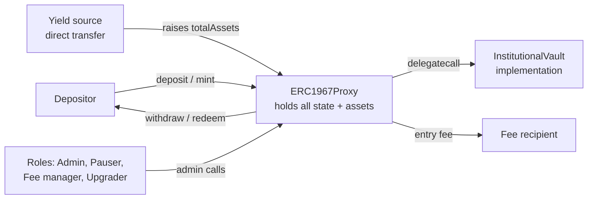
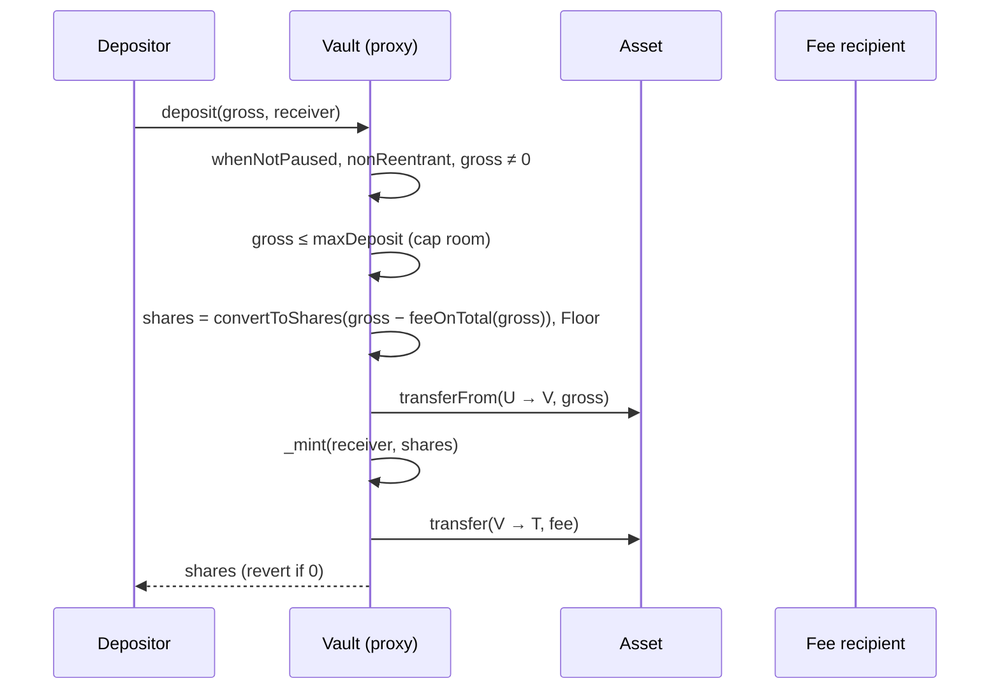

# InstitutionalVault — Architecture

An ERC-4626 tokenized vault for institutional deposits. It adds four controls on top of OpenZeppelin v5.7.0:

1. A defense against the first-depositor (inflation) attack.
2. An entry fee capped at 500 bps, sent to a fee recipient.
3. An admin-set deposit cap.
4. A pause with role-based access control.

The vault is deployed behind a UUPS proxy.

All numbers in this document come from the test suite. Each one names the test that produces it.

---

## 1. What is OpenZeppelin and what is custom

A reviewer cannot see this boundary by reading the code, so here it is in full.

| Component | Source | Notes |
|---|---|---|
| ERC-4626 share math, rounding, `deposit`/`mint`/`withdraw`/`redeem` flow | OZ `ERC4626Upgradeable` | Unmodified. Overridden only through public `virtual` hooks. |
| Virtual shares | OZ `_decimalsOffset()` | The vault only chooses the value (6). |
| Role management, two-step admin transfer with delay | OZ `AccessControlDefaultAdminRulesUpgradeable` | Unmodified. |
| Pause state | OZ `PausableUpgradeable` | Unmodified. |
| Reentrancy guard | OZ `ReentrancyGuardTransient` | Uses a fixed transient-storage slot, so it is proxy-safe. |
| Proxy + upgrade authorization | OZ `ERC1967Proxy` + `UUPSUpgradeable` | Unmodified. |
| Fee math (`_feeOnTotal`, `_feeOnRaw`, `preview*` overrides, `_deposit` transfer) | Pattern from OZ `mocks/docs/ERC4626Fees.sol` | That file is documentation example code, not an audited library contract. The vault copies its formulas exactly. |
| **Custom** | | |
| Dead-share seed inside `initialize` | Custom | §3.1 |
| Deposit cap and `maxDeposit`/`maxMint` logic | Custom | §2.4. Not in the brief bullets; added because of the "Capped" title. |
| Pause reflected in all four `max*` functions | Custom | Required by EIP-4626. OZ does not do it by default. |
| Zero-amount reverts | Custom | §3.4 |
| Fee recipient validation, role split, ERC-7201 namespace | Custom | |

---

## 2. System and accounting flow

### 2.1 Components



The proxy holds the assets, the shares and the state. The implementation holds only code. `totalAssets()` is the vault's balance of the asset (`asset.balanceOf(proxy)`).

### 2.2 Share price

OZ computes conversions as:

```
shares = assets × (totalSupply + 10^6) / (totalAssets + 1)
assets = shares × (totalAssets + 1) / (totalSupply + 10^6)
```

The `+ 10^6` and `+ 1` are the virtual shares and the virtual assets (offset = 6). Share decimals = asset decimals + 6, so a USDC vault has 12-decimal shares.

### 2.3 Deposit with fee

The fee is **net-based**, exactly as in the OZ reference. `depositFeeBps` is a percentage of the amount that buys shares, not of the gross amount sent.

| Entry point | User specifies | Fee formula | Rounding |
|---|---|---|---|
| `deposit(gross)` | Gross assets | `fee = gross × bps / (10_000 + bps)` | Ceil |
| `mint(shares)` | Shares | `net = convertToAssets(shares)` (Ceil), `fee = net × bps / 10_000` | Ceil |

Both entry points charge the same fee for the same net amount. `testFuzz_fee_mintPathFeeEqualsFeeOnRaw` and the invariant `invariant_feesMatchIndependentFormula` check this. The invariant compares the treasury balance against an independent formula over 16,384 random calls, with the fee changing between calls, and the two match exactly.

Worked example at 500 bps (`test_fee_maxBpsIsFivePercentOfNet`, `test_fee_maxBpsRoundsUpOnUnevenAmount`):

| Gross sent | Fee | Net invested | Fee ÷ net | Fee ÷ gross |
|---|---|---|---|---|
| 10,500 USDC | 500 USDC | 10,000 USDC | 5.00% | 4.76% |
| 1,000 USDC | 47.619048 USDC (rounded up) | 952.380952 USDC | 5.00% | 4.76% |



The order follows OZ: assets in, then shares minted, then the fee out. A deposit does not change the share price. The fee leaves the vault, and `invariant_sharePriceNeverDecreases` checks this.

**Why fee-to-recipient and not fee-stays-in-vault.** If the vault kept the fee, every deposit would raise the share price for existing holders. A searcher could then deposit just before a large deposit and redeem just after, and capture part of the fee with no exit fee to stop them. Sending the fee out keeps `totalAssets` equal to depositor capital, makes revenue visible as transfers, and removes that incentive.

### 2.4 Deposit cap

- `maxDeposit = depositCap − totalAssets`, or 0 when the cap is already reached. When the cap is `type(uint256).max`, the cap is off.
- The cap counts the **gross** amount, although only the net amount stays. A deposit of exactly `maxDeposit` therefore ends slightly below the cap. This underestimates the true limit, which EIP-4626 allows, and it can never overshoot (`test_cap_depositAboveRoomReverts`, `test_cap_mintAtMaxStaysUnderCap`).
- `maxMint = convertToShares(room)`, rounded Floor, so `mint(maxMint)` never exceeds the cap.
- The cap can be set below `totalAssets`. Then `max*` returns 0 and does not revert (`test_cap_belowTotalAssetsReturnsZeroWithoutRevert`).

### 2.5 Withdraw and redeem

No exit fee. OZ burns the shares **before** it transfers the assets out. The vault adds only `whenNotPaused`, `nonReentrant` and the zero-amount checks.

### 2.6 Yield accounting

The vault has no strategy. Yield is any increase in `asset.balanceOf(vault)`, for example a direct transfer from an off-chain desk or a future strategy module. Yield raises `totalAssets` and leaves `totalSupply` unchanged, so every share is worth more (`test_yield_raisesShareValueForHolders`). A loss lowers the price for all holders in equal proportion. With no strategy lag, no holder can exit at a stale price.

---

## 3. Threat model and mitigations

### 3.1 First-depositor inflation attack

**Attack.** The vault is empty. The attacker deposits 1 wei, then transfers a large donation straight to the vault. The next depositor's shares round down to 0 or 1, and the attacker redeems the victim's deposit.

**Mitigations (two layers):**

1. **Virtual shares, offset 6.** The virtual shares take most of any donation. To steal, the attacker must donate about 10^6 times more than the profit.
2. **Dead-share seed, atomic with deployment.** `initialize` pulls `seedAssets` from the deployer and mints the shares to `0xdead`. The vault is never empty, and no transaction exists between deployment and seeding for an attacker to front-run. `initialize` reverts if `seedAssets == 0`.

**Measured** (`test_attack_reportByDefense`, run with `-vv`). Victim deposits 10,000 USDC, attacker donates 10,000 USDC:

| Vault | Attacker P&L | Victim P&L |
|---|---|---|
| Naive share math (no virtual shares) | **+10,000.00** | −10,000.00 |
| OZ, offset 0, no seed | −3,333.33 | −3,333.33 |
| OZ, offset 3, no seed | −4,998.75 | −2.50 |
| OZ, offset 6, no seed | −4,999.99 | −0.0025 |
| **InstitutionalVault** (offset 6 + seed) | **−9,999.99** | **−0.000001** (1 wei) |

Findings:

- At offset 0, OZ v5 already turns the theft into griefing. The attacker loses as much as the victim.
- Each +3 of offset cuts the victim's loss by 1,000×.
- With the seed added, the victim loses 1 wei, and the attacker loses nearly the whole donation.
- `testFuzz_attack_neverProfitableAgainstInstitutionalVault` fuzzes donations from 1 wei to 1,000,000,000 USDC. The attacker P&L is never positive, and the victim always receives shares.

**Why offset 6.** USDC has 6 decimals, so share decimals become 12, well inside `uint256` range. The cost is that dead and virtual shares keep a negligible fraction of yield (1 base unit of virtual assets).

### 3.2 Share dilution edge cases

| Case | Effect | Handling |
|---|---|---|
| Fee manager raises the fee just before a large deposit (front-run) | Depositor pays up to 5% net | The fee is hard-capped at 500 bps. In production, `FEE_MANAGER_ROLE` sits behind a timelock, so changes are announced in advance. Integrators can use an ERC-5143-style router with `minShares`. |
| Direct donation | Raises the price for current holders. No dilution. | By design. This is also the yield path. |
| Deposit while the fee is non-zero | No dilution of existing holders: the fee leaves the vault | `invariant_sharePriceNeverDecreases` |
| Dead shares and virtual shares | Keep yield on 1 USDC of seed plus 1 virtual base unit, forever | Negligible. Documented cost of the defense. |
| Deposit that the fee consumes entirely (e.g. 1 wei) | Would mint 0 shares and donate the asset | Reverts with `ZeroAmount` (`test_fee_depositFullyConsumedByFeeReverts`) |
| Redeem of dust that pays 0 assets | Would burn shares for nothing | Reverts with `ZeroAmount` (`test_zero_redeemOfDustThatPaysNothingReverts`) |

### 3.3 Arithmetic and rounding

Every conversion rounds against the caller:

| Function | Rounding | Effect |
|---|---|---|
| `deposit` → shares | Floor | Fewer shares |
| `mint` → assets charged | Ceil | More assets |
| `withdraw` → shares burned | Ceil | More shares |
| `redeem` → assets paid | Floor | Fewer assets |
| Fee (both formulas) | Ceil | The protocol never under-charges |

All multiply-then-divide steps use `Math.mulDiv`, which has no intermediate overflow and makes the rounding direction explicit.

Evidence:

- `testFuzz_rounding_depositRedeemNeverProfits` and `testFuzz_rounding_mintWithdrawNeverProfits`: no round trip returns more than it costs.
- `test_rounding_previewsFavorVault`: each `preview*` result sits on the vault-favoring side of `convertTo*`.
- The a16z ERC-4626 property suite (26 properties) passes with `_delta_ = 0`, which is the strictest setting and allows no rounding error.
- `invariant_solvent`: `previewRedeem(totalSupply) ≤ asset.balanceOf(vault)` after every call.

### 3.4 Other threats

| Threat | Mitigation | Residual risk |
|---|---|---|
| Reentrancy through a token hook (ERC-777) | OZ ordering: assets in before mint, burn before assets out. `nonReentrant` (transient storage) on all four entry points. | None known for standard ERC-20 assets |
| Fee-on-transfer or rebasing assets | **Not supported.** Accounting assumes `transferFrom(x)` delivers exactly `x`. | Deployment checklist: whitelist plain ERC-20 assets only |
| Fee recipient blacklisted by the asset (USDC blacklist) or a reverting contract | Setter rejects `address(0)` and the vault itself | A blacklisted recipient blocks every fee-paying deposit until `FEE_MANAGER_ROLE` sets a new recipient. A pull-based fee (accrue, then claim) removes this dependency but costs one extra storage write per deposit. Push was chosen for simplicity. |
| Compromised pauser key | Can only pause. Cannot unpause, move funds or change parameters. | Denial of service until the admin unpauses |
| Compromised upgrader | Can replace the code and take everything | The highest-impact key. It must be held by a timelock controlled by a multisig (§4.3). |
| Compromised admin | `DEFAULT_ADMIN_ROLE` administers every role, so it can grant itself `UPGRADER_ROLE` and bypass the upgrader timelock. **Equal in power to the upgrader.** | The admin must also sit behind the timelock + multisig. Admin transfer is two-step with a delay (`AccessControlDefaultAdminRules`). |
| Pause traps users | Pause blocks withdrawals as well as deposits, as the brief requires | Trade-off: a pause during an exploit protects funds, but blocks honest exits. An alternative is separate deposit and withdrawal pause flags. Kept as one flag to match the brief. |
| Zero-amount reverts | Stop zero-share deposits and zero-asset redeems | EIP-4626 does not require zero amounts to succeed. Some integrators call `deposit(0)` as a no-op. Documented deviation from OZ default behavior. |

---

## 4. Production readiness and upgradeability

### 4.1 Pattern choice: UUPS

| | UUPS (chosen) | Transparent proxy |
|---|---|---|
| Upgrade logic lives in | Implementation | Proxy + separate `ProxyAdmin` |
| Gas per user call | No admin check | Compares `msg.sender` with the admin on every call (an `immutable` in OZ v5, so the difference is small) |
| Extra contracts | None | One `ProxyAdmin` per proxy |
| Access control for upgrades | Same `AccessControl` roles as the rest of the vault (`UPGRADER_ROLE`) | A separate `ProxyAdmin` ownership model |
| Can be made immutable later | Yes: upgrade to an implementation without `upgradeToAndCall` | No |
| Main risk | Upgrading to an implementation without UUPS support bricks the proxy | Admin cannot call implementation functions (selector clash rules) |

**Why UUPS.** One role system governs everything, user calls are cheaper, and the option to freeze the code later matters for institutions that want a path to immutability. The bricking risk has two mitigations: OZ checks `proxiableUUID()` on every upgrade (`test_upgrade_rejectsNonUUPSImplementation`), and only the `UPGRADER_ROLE` can upgrade (`test_upgrade_onlyUpgrader`).

### 4.2 Storage collision prevention

- **ERC-7201 namespaced storage.** All OZ v5 upgradeable contracts keep their state in hashed namespaces. The vault's own state lives in `erc7201:capitalsage.storage.InstitutionalVault`, at slot `0x8591…ab800`. The slot formula is in the source next to the constant.
- **No linear storage.** `forge inspect InstitutionalVault storageLayout` returns an empty table. Any new variable in a V2 must go into the namespace struct, appended at the end.
- **Initializer safety.** The constructor calls `_disableInitializers()`, so nobody can initialize the implementation (`test_initialize_implementationIsLocked`). The proxy cannot be re-initialized (`test_initialize_revertsOnProxyReinit`).
- **Upgrade test.** `test_upgrade_preservesStateAndBalances` upgrades to a V2 and checks balances, fee settings and roles afterwards.

### 4.3 Roles

| Role | Can | Recommended holder |
|---|---|---|
| `DEFAULT_ADMIN_ROLE` | Grant and revoke roles (including `UPGRADER_ROLE`), unpause, set the deposit cap | `TimelockController` with a multisig (e.g. 3-of-5) as proposer. Because it can grant `UPGRADER_ROLE`, it needs the same protection as the upgrader. Transfer is two-step with a delay. |
| `PAUSER_ROLE` | Pause only | Operations key and monitoring bot: fast reaction |
| `FEE_MANAGER_ROLE` | Set the fee (≤ 500 bps) and the fee recipient | Timelock, so fee changes are visible before they apply |
| `UPGRADER_ROLE` | Upgrade the implementation | `TimelockController` (e.g. 48 h) with the multisig as proposer |

The design separates pausing from unpausing on purpose: **fast to stop, slow to restart**. A single operations key can stop the vault in one transaction, but a restart needs the multisig.

### 4.4 Operational emergency controls

**Incident runbook:**

1. **Detect.** A monitoring rule fires, for example a share-price drop, an unexpected `Upgraded` event or an unusual outflow.
2. **Stop.** `PAUSER_ROLE` calls `pause()` (31,014 gas). All four entry points revert with `EnforcedPause`, and every `max*` returns 0, so integrators see the pause before they call.
3. **Fix.** If code is at fault, deploy a patched implementation. The upgrade works while paused (`test_upgrade_worksWhilePaused`), and the timelock delay applies unless the multisig holds an emergency path.
4. **Restart.** The admin multisig calls `unpause()`.

**Upgrade procedure:**

1. Add new state only to the end of the `VaultStorage` struct.
2. Compare `forge inspect … storageLayout` before and after. Run the OZ Upgrades validation (`OpenZeppelin/openzeppelin-foundry-upgrades`) in CI.
3. Schedule `upgradeToAndCall` through the timelock, then execute it after the delay.

---

## 5. Gas

Measured with `vm.snapshotGasLastCall`, one operation per test, cold storage, through the proxy. The values exclude the 21,000 base cost of a transaction. Source: `snapshots/GasBenchmarkTest.json`, regenerated by `make gas`.

| Operation | Gas |
|---|---|
| `deposit`, new holder, fee 100 bps | 77,537 |
| `deposit`, new holder, fee 0 | 68,784 |
| `deposit`, existing holder, fee 100 bps | 60,437 |
| `mint`, existing holder, fee 100 bps | 60,475 |
| `withdraw`, partial | 46,650 |
| `redeem`, full | 37,538 |
| `pause` | 31,014 |
| `setDepositFee` | 14,290 |
| Baseline: plain OZ `ERC4626`, `deposit`, new holder | 52,517 |

Cost of the features over plain OZ, for a deposit by a new holder:

- **+16,267 gas without a fee.** This covers the proxy `delegatecall` and implementation-slot read, the pause and cap checks, the transient reentrancy guard, and the `asset` address read. An upgradeable contract cannot store `asset` as an `immutable`, so every call pays an extra cold storage read for it. The split between these items is an estimate; only the total is measured.
- **+8,753 gas for the fee transfer** (measured: 77,537 − 68,784).

Choices made for gas:

- `feeRecipient` (20 bytes) and `depositFeeBps` (2 bytes) share one storage slot, so the fee path reads one cold slot.
- `ReentrancyGuardTransient` uses `TSTORE`/`TLOAD` (100 gas per opcode by EIP-1153) instead of `SSTORE`/`SLOAD` on a regular slot. These are opcode prices, not measurements.
- Custom errors throughout. The fee is skipped when it is zero.

Runtime bytecode: 14,242 bytes, with 10,334 bytes of margin below the EIP-170 limit (`forge build --sizes`).

---

## 6. Test suite

| Suite | Tests | What it proves |
|---|---|---|
| `InstitutionalVault.t.sol` | 39 | All four flows, exact fee values at 0 / 100 / 500 bps, fuzzed rounding, zero amounts, pause, every role check, the cap, initialization |
| `InflationAttack.t.sol` | 5 | The attack succeeds on naive math, is griefing-only at offset 0, and is never profitable against this vault (fuzzed) |
| `Upgrade.t.sol` | 5 | State survives an upgrade. Only the upgrader can upgrade. Non-UUPS targets are rejected. Upgrade works while paused. The implementation rejects direct calls. |
| `ERC4626Compliance.t.sol` | 26 | The a16z ERC-4626 property suite, `_delta_ = 0`, with the fee on |
| `invariant/VaultInvariants.t.sol` | 4 | Solvency, share price never decreases, fees match an independent formula, supply equals the sum of holders. 256 runs × 64 calls, 0 reverts. |
| `GasBenchmark.t.sol` | 9 | Gas figures for §5 |

Coverage of `src/InstitutionalVault.sol` (`make coverage`): 100% of lines, statements, branches and functions.

**Known limits of the evidence:**

- The a16z suite **discards** inputs that make the vault revert (`vm.assume(false)` in its harness). It therefore does not exercise the zero-amount reverts, which the unit tests cover.
- The compliance harness excludes the fee recipient as a fuzzed caller. A depositor who is also the fee recipient gets the fee back, which breaks the suite's caller-balance assertion. That is a property of the harness, not of the vault.
- Every test uses a standard 6-decimal mock token. Fee-on-transfer and rebasing tokens are out of scope (§3.4).

---

## 7. Runbook

Requires [Foundry](https://book.getfoundry.sh/getting-started/installation) (tested with `forge 1.0.0-stable`) and `make`.

```sh
git clone --recurse-submodules <repo-url> && cd institutional-vault
make all          # install submodules → build (with sizes) → full test suite → gas benchmarks
```

| Command | Does |
|---|---|
| `make test` | All suites (fuzz 1,000 runs) |
| `FOUNDRY_PROFILE=ci forge test` | All suites at 10,000 fuzz runs |
| `make gas` | Gas benchmarks, then prints `snapshots/GasBenchmarkTest.json` |
| `make snapshot` | Writes `.gas-snapshot` for the deterministic tests |
| `make coverage` | Coverage summary for `src/` |
| `make deploy-local` | Starts anvil, deploys a mock USDC and the vault through `script/Deploy.s.sol`, verifies the predicted proxy address |
| `forge test --match-test test_attack_reportByDefense -vv` | Prints the inflation-attack table from §3.1 |

**Production deployment.** `script/Deploy.s.sol:run()` reads `ASSET`, `VAULT_NAME`, `VAULT_SYMBOL`, `ADMIN`, `ADMIN_DELAY`, `FEE_RECIPIENT`, `FEE_BPS`, `DEPOSIT_CAP` and `SEED_ASSETS` from the environment. The deployer must hold `SEED_ASSETS`. The script approves the predicted proxy address, deploys, and reverts with `ProxyAddressMismatch` if the prediction is wrong. After deployment, the admin multisig grants `PAUSER_ROLE`, `FEE_MANAGER_ROLE` and `UPGRADER_ROLE`.
