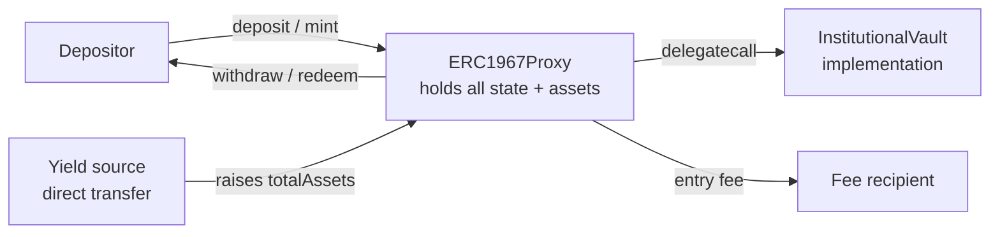
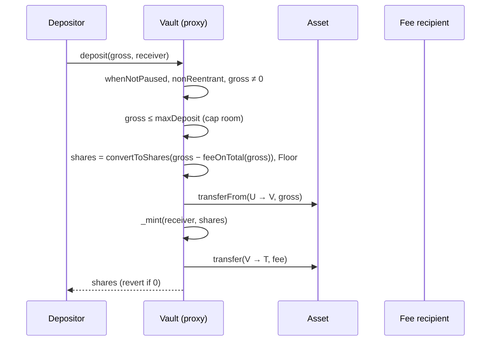

# InstitutionalVault — Architecture

An ERC-4626 vault on OpenZeppelin v5.7.0, deployed behind a UUPS proxy, with an inflation defense, a deposit fee capped at 500 bps, a deposit cap, and a role-gated pause.

Every number in this document is measured, and each one names the test that produces it.

---

## 1. System & Accounting Flow

### 1.1 Asset and share flow



The proxy holds the assets, the shares and all state. The implementation holds only code. `totalAssets()` is the vault's balance of the asset (`asset.balanceOf(proxy)`).

Conversions (OZ, unmodified):

```
shares = assets × (totalSupply + 10^6) / (totalAssets + 1)
assets = shares × (totalAssets + 1) / (totalSupply + 10^6)
```

The `+ 10^6` and `+ 1` are the virtual shares and the virtual asset (offset = 6). Share decimals = asset decimals + 6, so a USDC vault has 12-decimal shares.

| Flow | User gives | User gets | Fee |
|---|---|---|---|
| `deposit(assets)` | assets | shares | yes, taken from `assets` |
| `mint(shares)` | assets (net + fee) | shares | yes, added on top |
| `withdraw(assets)` | shares | assets | no |
| `redeem(shares)` | shares | assets | no |

On entry, OZ pulls the assets in before it mints the shares. On exit, OZ burns the shares before it sends the assets out.

**Deposit cap.** `maxDeposit = depositCap − totalAssets`, or 0 when the cap is reached. A cap of `type(uint256).max` means no cap. The cap counts the gross deposit, although only the net amount stays, so the vault can stop slightly below the cap but can never exceed it (`test_cap_depositAboveRoomReverts`, `test_cap_mintAtMaxStaysUnderCap`). If the admin sets the cap below `totalAssets`, `maxDeposit` and `maxMint` return 0 and do not revert (`test_cap_belowTotalAssetsReturnsZeroWithoutRevert`).

### 1.2 Deposit fee deductions

The fee is **net-based**, as in the OZ reference (`mocks/docs/ERC4626Fees.sol`). `depositFeeBps` is a percentage of the amount that buys shares, not of the gross amount sent.

| Entry point | User specifies | Fee formula | Rounding |
|---|---|---|---|
| `deposit(gross)` | Gross assets | `fee = gross × bps / (10_000 + bps)` | Ceil |
| `mint(shares)` | Shares | `net = convertToAssets(shares)` (Ceil), `fee = net × bps / 10_000` | Ceil |

Both entry points charge the same fee for the same net amount (`testFuzz_fee_mintPathFeeEqualsFeeOnRaw`). The invariant `invariant_feesMatchIndependentFormula` compares the fee recipient's balance against an independent formula over 16,384 random calls (256 runs × 64 calls), with the fee changing between calls. The two match exactly.

Worked example at 500 bps (`test_fee_maxBpsIsFivePercentOfNet`, `test_fee_maxBpsRoundsUpOnUnevenAmount`):

| Gross sent | Fee | Net invested | Fee ÷ net | Fee ÷ gross |
|---|---|---|---|---|
| 10,500 USDC | 500 USDC | 10,000 USDC | 5.00% | 4.76% |
| 1,000 USDC | 47.619048 USDC (rounded up) | 952.380952 USDC | 5.00% | 4.76% |



**Why the fee goes to a recipient and does not stay in the vault.** A fee kept in the vault raises the share price for the current holders on every deposit. A searcher could deposit just before a large deposit and redeem just after, and take part of that fee, because there is no exit fee. Sending the fee out keeps `totalAssets` equal to depositor capital and makes revenue visible as transfers. A deposit therefore never lowers the share price (`invariant_sharePriceNeverDecreases`).

### 1.3 Yield accounting

The vault has no strategy. Yield is any increase in `asset.balanceOf(vault)`, for example a transfer from an off-chain desk or a future strategy module. Yield raises `totalAssets` and leaves `totalSupply` unchanged, so every share is worth more (`test_yield_raisesShareValueForHolders`). A loss lowers the price for all holders in equal proportion. Because nothing is deployed to a strategy, the price is never out of date, and no holder can exit at a stale price.

---

## 2. Threat Modeling & Mitigation

### 2.1 First-depositor inflation attack

**Attack.** The vault is empty. The attacker deposits 1 wei, then transfers a large donation straight to the vault. The donation raises `totalAssets` but mints no shares. The next depositor's shares round down to 0, and the attacker redeems the victim's deposit.

**Mitigation, two independent layers:**

1. **Virtual shares, offset 6.** The conversion counts 10^6 shares that nobody owns, so any donation is shared with them. After a 1-wei deposit, the attacker holds 10^6 shares, beside 10^6 virtual shares. To round a victim's deposit `V` down to 0, the attacker must donate more than about `2 × V × 10^6`, and loses about half of the donation to the virtual shares.
2. **Dead-share seed, atomic with deployment.** `initialize` pulls `seedAssets` from the deployer and mints the shares to `0xdead`. The vault is never empty. The proxy constructor runs `initialize`, so deployment and seeding happen in one transaction, and no gap exists for an attacker to act in. `initialize` reverts if `seedAssets == 0` (`test_initialize_revertsOnZeroSeed`).

**Measured** (`test_attack_reportByDefense`, run with `-vv`). The victim deposits 10,000 USDC, and the attacker donates 10,000 USDC:

| Vault | Attacker P&L | Victim P&L |
|---|---|---|
| Naive share math (no virtual shares) | **+10,000.00** | −10,000.00 |
| OZ, offset 0, no seed | −3,333.33 | −3,333.33 |
| OZ, offset 3, no seed | −4,998.75 | −2.50 |
| OZ, offset 6, no seed | −4,999.99 | −0.0025 |
| **InstitutionalVault** (offset 6 + seed) | **−9,999.99** | **−0.000001** (1 wei) |

- At offset 0, OZ v5 already turns the theft into griefing: the attacker loses as much as the victim.
- Each +3 of offset cuts the victim's loss by 1,000×.
- With the seed, the attacker holds about 0.0001% of the shares. The victim loses 1 wei, and the attacker loses nearly the whole donation.
- `testFuzz_attack_neverProfitableAgainstInstitutionalVault` fuzzes donations from 1 wei to 1,000,000,000 USDC. The attacker P&L is never positive, and the victim always receives shares.

**Cost of offset 6.** Shares have 12 decimals. The virtual shares and the 1 USDC of dead shares keep a negligible fraction of all future yield.

### 2.2 Share dilution edge cases

| Case | Effect | Handling |
|---|---|---|
| Fee manager raises the fee just before a large deposit | Depositor pays up to 5% of net | Hard cap of 500 bps. `FEE_MANAGER_ROLE` sits behind a timelock, so a change is visible before it applies. Integrators can use a router with a `minShares` check. |
| Direct donation | Raises the price for current holders. No dilution. | By design. This is also the yield path. |
| Deposit while the fee is non-zero | No dilution: the fee leaves the vault | `invariant_sharePriceNeverDecreases` |
| Dead shares and virtual shares | Keep yield on 1 USDC of seed and 1 virtual base unit, forever | Negligible. The documented cost of the defense. |
| Deposit that the fee consumes entirely (1 wei) | Would mint 0 shares and donate the asset | Reverts with `ZeroAmount` (`test_fee_depositFullyConsumedByFeeReverts`) |
| Redeem of dust that is worth 0 assets | Would burn shares for nothing | Reverts with `ZeroAmount` (`test_zero_redeemOfDustThatPaysNothingReverts`) |

### 2.3 Arithmetic rounding protections

Every conversion rounds against the caller, so no sequence of operations can create value from rounding:

| Function | Rounding | Effect on the caller |
|---|---|---|
| `deposit` → shares received | Floor | Fewer shares |
| `mint` → assets charged | Ceil | More assets |
| `withdraw` → shares burned | Ceil | More shares |
| `redeem` → assets paid | Floor | Fewer assets |
| Fee, both formulas | Ceil | The protocol never undercharges, and splitting a deposit cannot avoid the fee |

Every multiply-then-divide step uses `Math.mulDiv`, which keeps a 512-bit intermediate (no overflow before the division) and takes an explicit rounding direction. Solidity 0.8 checks all other arithmetic. `maxDeposit` compares the cap with `totalAssets` before it subtracts, so it cannot revert.

Evidence:

- `testFuzz_rounding_depositRedeemNeverProfits` and `testFuzz_rounding_mintWithdrawNeverProfits`: no round trip returns more than it costs.
- `test_rounding_previewsFavorVault`: each `preview*` result sits on the vault's side of `convertTo*`.
- The a16z ERC-4626 property suite (`ERC4626Compliance.t.sol`, 26 properties) passes with `_delta_ = 0`, which allows no rounding error.
- `invariant_solvent`: `previewRedeem(totalSupply) ≤ asset.balanceOf(vault)` after every call.

---

## 3. Production Readiness & Upgradeability

### 3.1 Upgradeability pattern for institutional deployment: UUPS

| | UUPS (chosen) | Transparent proxy |
|---|---|---|
| Upgrade logic lives in | The implementation | The proxy, plus a separate `ProxyAdmin` |
| Per-call overhead | No admin check | Compares `msg.sender` with the admin on every call (an `immutable` in OZ v5, so the difference is small) |
| Extra contracts | None | One `ProxyAdmin` per proxy |
| Upgrade authorization | The same `AccessControl` roles as the rest of the vault (`UPGRADER_ROLE`) | A separate ownership model on `ProxyAdmin` |
| Can be made immutable later | Yes: upgrade to an implementation without an upgrade function | No |
| Main risk | Upgrading to an implementation without UUPS support | Selector clashes between the proxy admin and the implementation |

**Why UUPS for an institution.** One role system governs every power, including upgrades, so one multisig and timelock setup covers everything. User calls carry no admin check. The vault can later be frozen, which gives depositors a credible path to immutable code. OZ checks `proxiableUUID()` on every upgrade, so an upgrade to a non-UUPS contract reverts (`test_upgrade_rejectsNonUUPSImplementation`). Only `UPGRADER_ROLE` can upgrade (`test_upgrade_onlyUpgrader`). Upgrade calls made directly on the implementation revert (`test_upgrade_implementationRejectsDirectCall`).

**Roles:**

| Role | Can | Recommended holder |
|---|---|---|
| `DEFAULT_ADMIN_ROLE` | Grant and revoke roles, unpause, set the deposit cap | `TimelockController` with a multisig (e.g. 3-of-5) as proposer. It can grant itself `UPGRADER_ROLE`, so it is equal in power to the upgrader and needs the same protection. Transfer is two-step with a delay (`test_defaultAdminTransfer_enforcesDelay`). |
| `PAUSER_ROLE` | Pause only | Operations key and monitoring bot, for a fast reaction |
| `FEE_MANAGER_ROLE` | Set the fee (≤ 500 bps) and the fee recipient | Timelock, so fee changes are visible before they apply |
| `UPGRADER_ROLE` | Upgrade the implementation | `TimelockController` (e.g. 48 h) with the multisig as proposer |

### 3.2 Storage collision prevention

- **ERC-7201 namespaced storage.** All OZ v5 upgradeable parents keep their state in hashed namespaces. The vault's own state lives in `erc7201:capitalsage.storage.InstitutionalVault`, at slot `0x8591…ab800`. The slot formula is in the source next to the constant.
- **No linear storage.** `forge inspect InstitutionalVault storageLayout` returns an empty table, so no variable uses slots 0, 1, 2…
- **Initializer safety.** The implementation's constructor calls `_disableInitializers()`, so nobody can initialize the implementation (`test_initialize_implementationIsLocked`). The proxy cannot be initialized twice (`test_initialize_revertsOnProxyReinit`).
- **Upgrade test.** `test_upgrade_preservesStateAndBalances` upgrades to a V2 and checks the balances, the fee settings and the roles afterwards.
- **Rules for every upgrade:**
  1. Append new fields to the end of `VaultStorage`. Never reorder, remove or retype a field.
  2. Never change a constant that existing state depends on: `DECIMALS_OFFSET` (share math and `decimals()`), the role IDs, `VAULT_STORAGE_SLOT`. Constants live in the bytecode, so an upgrade replaces them.
  3. Compare `forge inspect InstitutionalVault storageLayout` before and after, and run the OZ Upgrades validation (`OpenZeppelin/openzeppelin-foundry-upgrades`) before the upgrade.
  4. Schedule `upgradeToAndCall` through the timelock, and execute it after the delay.

### 3.3 Operational emergency controls

**Fast to stop, slow to restart.** `PAUSER_ROLE` can only pause. Only `DEFAULT_ADMIN_ROLE` can unpause (`test_pause_onlyAdminCanUnpause`). A compromised pauser key can therefore freeze the vault, but cannot move funds, change parameters or restart it.

**What a pause does** (`test_pause_blocksAllFlowsAndZeroesMax`):

- `deposit`, `mint`, `withdraw` and `redeem` revert with `EnforcedPause`.
- `maxDeposit`, `maxMint`, `maxWithdraw` and `maxRedeem` return 0, as EIP-4626 requires, so integrators see the pause before they call.
- Upgrades still work, so a fix can be installed while the vault is paused (`test_upgrade_worksWhilePaused`).

**Trade-off.** The pause blocks withdrawals as well as deposits, as the brief asks. During an exploit this protects the remaining funds, but it also blocks honest exits. For this reason, a restart needs the admin multisig, and a pause is meant to be short.

**Incident runbook:**

1. **Detect.** A monitoring rule fires: a share-price drop, an unexpected `Upgraded` event, or an unusual outflow.
2. **Stop.** `PAUSER_ROLE` calls `pause()` (31,014 gas, `test_gas_pause`).
3. **Fix.** If code is at fault, deploy a patched implementation and upgrade through the timelock, following the rules in §3.2.
4. **Restart.** The admin multisig calls `unpause()`.

---

## 4. Runbook

Requires [Foundry](https://book.getfoundry.sh/getting-started/installation) `v1.0.0` (the version CI pins) and `make`.

```sh
git clone --recurse-submodules https://github.com/yraeonti/capitalsageholdings.git && cd capitalsageholdings
make all
```

`make all` runs four steps, and stops at the first failure:

| Step | Command | Result |
|---|---|---|
| Install dependencies | `git submodule update --init --recursive` | forge-std v1.17.0, OpenZeppelin v5.7.0 (contracts and upgradeable), pinned by commit |
| Build | `forge build --sizes` | Runtime bytecode 14,242 bytes, 10,334 bytes below the EIP-170 limit |
| Run the test suite | `FORGE_SNAPSHOT_CHECK=true forge test` | 88 tests in 6 suites |
| Verify gas benchmarks | `FORGE_SNAPSHOT_CHECK=true forge test --match-contract GasBenchmarkTest` | Fails if any figure differs from `snapshots/GasBenchmarkTest.json`, then prints the file |

**Gas benchmarks.** One operation per test, cold storage, through the proxy, excluding the 21,000 base cost of a transaction (`test/GasBenchmark.t.sol`):

| Operation | Gas |
|---|---|
| `deposit`, new holder, fee 100 bps | 77,537 |
| `deposit`, new holder, fee 0 | 68,784 |
| `deposit`, existing holder, fee 100 bps | 60,437 |
| `mint`, existing holder, fee 100 bps | 60,475 |
| `withdraw`, partial | 46,650 |
| `redeem`, full | 37,538 |
| `pause` | 31,014 |
| `setDepositFee` | 14,290 |
| Baseline: plain OZ `ERC4626` `deposit`, new holder | 52,517 |

The fee transfer costs 8,753 gas (77,537 − 68,784), and the vault skips it when the fee is 0. The remaining 16,267 gas over plain OZ covers the proxy `delegatecall`, the pause, cap and reentrancy checks, and the storage read of `asset`, which an upgradeable contract cannot keep in an `immutable`. Only the total is measured. `feeRecipient` and `depositFeeBps` share one storage slot, so the fee path reads one cold slot.

After a deliberate gas change, `make gas-update` regenerates the snapshot.

**Other commands:**

| Command | Does |
|---|---|
| `FOUNDRY_PROFILE=ci forge test` | All suites at 10,000 fuzz runs |
| `make coverage` | Coverage summary for `src/` |
| `make deploy-local` | Starts anvil, deploys a mock USDC and the vault through `script/Deploy.s.sol`, and checks the predicted proxy address |
| `forge test --match-test test_attack_reportByDefense -vv` | Prints the attack table in §2.1 |

**Production deployment.** `script/Deploy.s.sol:run()` reads `ASSET`, `VAULT_NAME`, `VAULT_SYMBOL`, `ADMIN`, `ADMIN_DELAY`, `FEE_RECIPIENT`, `FEE_BPS`, `DEPOSIT_CAP` and `SEED_ASSETS` from the environment. The deployer must hold `SEED_ASSETS`. The script approves the predicted proxy address, deploys, and reverts with `ProxyAddressMismatch` if the prediction is wrong. After deployment, the admin multisig grants `PAUSER_ROLE`, `FEE_MANAGER_ROLE` and `UPGRADER_ROLE`.
